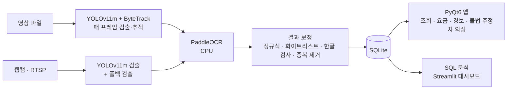
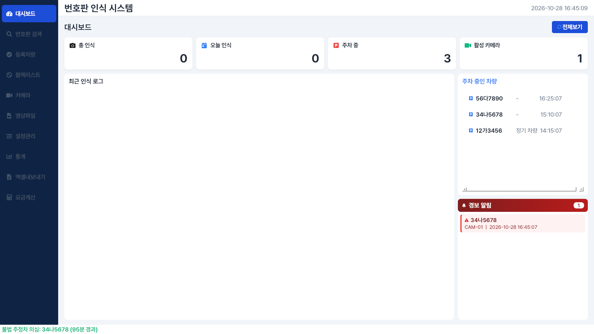

# LPR_System — 번호판 인식 주차 관리 시스템

영상에서 차량 번호판을 검출·인식해 입·출차 기록을 SQLite에 저장하고,
쌓인 기록을 SQL로 분석하는 개인 프로젝트.


*영상 파일 처리 화면. 번호판이 모자이크된 CCTV 영상이라 검출 박스만 표시되고 번호는 읽지 못한 상태(3장 참고).*

---

## 개요

| 항목 | 내용 |
|---|---|
| 목표 | 번호판 인식 결과를 입·출차 기록으로 저장하고, 이 기록을 이용 패턴·매출 분석에 사용 |
| 범위 | 검출 모델 학습, 인식 파이프라인, 데스크톱 앱, DB 설계, SQL 분석 대시보드, 인식 실패 원인 검증 |
| 데이터 | 검출 학습: AIHub 차량 이미지 10만 장 / 인식 검증: 직접 촬영한 도로 영상 6개 / 분석: 직접 생성한 4주 입·출차 데이터 |
| 기술 | Python, YOLOv11 (Ultralytics), ByteTrack, PaddleOCR, OpenCV, PyQt6, SQLite, SQL, Streamlit, Plotly |

## 핵심 내용

| 구분 | 내용 | 근거 |
|---|---|---|
| 원인 검증 | 실제 영상 인식 실패를 검출·OCR 단계로 나누어 측정하고, 검출 실패 원인이 학습 데이터의 번호판 모자이크임을 대조 실험으로 확인 | [3장](#3-검증-실험-인식-실패-원인-분리), [실험 문서](experiments/detector_ocr_check/README.md) |
| 인식 결과 보정 | 정규식 형식 추출, 화이트리스트 교정 조건 제한, 한글 검사, 편집거리 기반 중복 제거 | [2장](#2-인식-파이프라인), [3장 비교 4](#비교-4-한글-검사-없음-vs-적용) |
| DB 설계 | 인식 로그와 입·출차 이벤트를 분리한 6개 테이블, 조회 조건 기준 인덱스 8개 | [4장](#4-db-설계) |
| 불법 주정차 의심 기록 | 미등록 차량이 60분 이상 연속 체류하면 입차 1건당 한 번 기록하고 경보 알림에 표시 | [4장](#불법-주정차-의심-기록) |
| SQL 분석 | LAG로 입·출차 행을 방문 1건으로 묶고, 요금 규칙을 CASE 문으로 옮겨 매출 집계 | [5장](#5-데이터-분석) |
| 실행 환경 | GPU 라이브러리 충돌, 패키지 버전 충돌의 원인 확인 후 실행 환경 분리 | [6장](#6-문제-해결) |

---

## 시스템 구성



---

## 1. 검출 모델 학습

| 항목 | 내용 |
|---|---|
| 데이터 | AIHub 차량 이미지 라벨 10만 개, JSON 라벨을 YOLO 형식으로 변환 (`json_to_yolo.py`) |
| 분할 | 학습 9만 / 검증 1만, 무작위 9:1 (`make_val.py`) |
| 모델 | YOLOv11m, 클래스 1개(plate) |
| 설정 | 100 epoch, 입력 640px, batch 16, patience 20 (`train.py`) |
| 학습 시간 | 약 49시간 (GPU 1장) |
| 결과 (100 epoch, 검증 데이터) | Precision 0.958 · Recall 0.958 · mAP50 0.931 · mAP50-95 0.862 |


검증 데이터 번호판 9,999개 중 9,582개를 검출했고(놓침 417개), 번호판이 아닌 영역을 검출한 경우는 419개였다.

> **검증 지표의 한계**
> 학습·검증 데이터 모두 AIHub 이미지라 번호판이 모자이크되어 있다.
> 1 epoch에서 이미 Precision 0.957, Recall 0.958이었고 이후 거의 변하지 않았다.
> 실제 번호판 영상에서는 0건 검출이었고, 원인은 3장에서 확인했다.

---

## 2. 인식 파이프라인

### 영상 파일 모드 (`app_pyqt6.py`, `detector.track_plates`)

- 매 프레임 YOLO 추적(ByteTrack)으로 번호판 위치와 추적 ID를 유지한다. 검출 신뢰도 기준은 0.07이다.
- OCR은 작업 스레드 1개에서 처리한다. 추적과 화면 갱신은 OCR 결과를 기다리지 않고 매 프레임 진행된다.
  측정값: 검출·추적 1080p 프레임당 24.6ms(GPU), OCR 번호판 1장 약 1초(CPU). OCR을 프레임 처리 안에서 기다리면 화면 갱신이 멈춘다.
- 아직 번호가 확정되지 않은 추적 ID 중 가장 큰 번호판을 먼저 OCR에 보낸다.
  같은 ID는 0.5초 간격으로 다시 시도하고, 번호가 확정된 ID는 다시 읽지 않는다.
- 화면 표시용 프레임은 가로 960px로 줄인 뒤 박스와 번호를 그린다.

### 카메라 모드 (`pipeline.process_stream`)

- 웹캠·RTSP 입력은 프레임마다 `process_frame`으로 처리한다.
- YOLO 결과가 없거나 녹색 번호판 색이 보이면 폴백 검출(이진화·윤곽선·색상)을 함께 실행한다.

### OCR과 결과 보정 (`ocr_engine.py`, `pipeline.py`)

| 단계 | 처리 | 이유 |
|---|---|---|
| 색 분류 | HSV 범위로 흰색·노란색·녹색·파란색 번호판 구분 | 구형(녹색) 번호판은 신뢰도 기준을 낮춰 적용 |
| OCR | PaddleOCR(한국어 기본 모델, CPU), 신뢰도 0.20 미만 결과 제외 (구형 0.15) | |
| OCR 입력 선택 | 원본 번호판 영역 높이가 32px 이상이면 원본, 미만이면 확대한 전처리 이미지 사용 | 먼 차량처럼 작은 영역은 원본에 글자 정보가 부족 |
| 형식 추출 | 인식한 줄을 위에서 아래 순서로 이어 붙이고 정규식 3종(신형 2~3자리, 2자리, 지역명 포함 구형)으로 번호 추출 | 번호판 밖 글자 제거 |
| 줄 순서 재시도 | 형식 추출 실패 시 줄 순서를 뒤집어 다시 추출 | 2줄 번호판에서 줄 순서가 바뀌어 인식되는 경우 |
| 화이트리스트 교정 | 등록 번호와 길이가 같고 한 글자만 다르며 후보가 하나일 때만 등록 번호로 교정 | 길이가 다른 경우까지 교정하면 2자리 번호판이 3자리 등록 번호로 잘못 바뀔 수 있음 |
| 한글 검사 | 번호판 용도 기호 40자에 없는 한글이 나오면 결과를 버리고 다시 읽음 (등록 차량 번호와 같으면 통과) | 실험에서 오답 7건 중 6건 제외, 정답 제외 0건 (3장 비교 4) |
| 중복 제거 | 120초 안에 편집거리 2 이하 번호가 다시 나오면 같은 차량으로 보고 첫 기록만 유지 | 한 차량이 프레임마다 조금씩 다르게 인식되는 경우 |
| 기록 | `plate_logs` 저장, 카메라 방향(입차·출차·양방향)에 따라 `entry_exit_log` 기록, 블랙리스트 차량이면 경보 팝업 | |

---

## 3. 검증 실험: 인식 실패 원인 분리

이전 버전(YOLO n + EasyOCR)은 직접 촬영한 도로 영상에서 번호판을 거의 읽지 못했고,
대부분의 프레임이 폴백 검출로 넘어갔다.
원인이 검출 단계인지 OCR 단계인지 구분하기 위해 영상 6개(1초 간격 185프레임)에서 조건을 하나씩 바꾸어 비교했다.
이전 버전의 YOLO n 가중치는 남아 있지 않아 현재 모델(YOLOv11m)과 현재 폴백 코드로 측정했다.

| 비교 | 바꾼 조건 | 결과 |
|---|---|---|
| 1 | 같은 번호판을 원본 / 모자이크로 바꾸어 YOLO 검출 | 원본 0건, 모자이크 21건 (22개 중) |
| 2 | YOLO 검출 / 폴백 검출 | YOLO 0건, 폴백 후보 640개 중 번호판 형식 문자열 32개(5.0%) |
| 3 | 같은 번호판 영역을 PaddleOCR / EasyOCR로 인식 | PaddleOCR 15/21, EasyOCR 13/21 |
| 4 | 한글 검사 없음 / 적용 | 오답 7건에서 1건, 정답 21건 유지 |

### 비교 1. 원본 번호판 vs 모자이크 번호판

학습에 쓴 AIHub 이미지는 번호판이 모자이크되어 있다.
같은 영역에서 번호판을 모자이크하거나, 번호판은 그대로 두고 차체 일부를 모자이크한 뒤 YOLO 결과를 비교했다.


| 조건 | 차량 중심 영역 | 전체 프레임 |
|---|---|---|
| 원본 번호판 | 0 / 22 | 0 / 22 |
| 번호판 모자이크 | 21 / 22 | 14 / 22 |
| 차체 일부 모자이크 (번호판 원본 유지) | 7 / 10 | 5 / 22 |

**결과:** 모델은 글자가 있는 번호판이 아니라 학습 데이터의 **모자이크 무늬**를 번호판으로 학습했다.
더 큰 m 모델도 0건이므로 모델 크기(n·m)는 검출 실패의 원인이 아니었다.

### 비교 2. YOLO 검출 vs 폴백 검출


| 검출 방식 | 185프레임에서 나온 영역 | 번호판 형식 문자열이 나온 영역 |
|---|---|---|
| YOLOv11m | 0 | 0 |
| 폴백 (이진화·윤곽선·색상) | 640 (프레임당 평균 3.5) | 32 (5.0%) |

**결과:** 폴백 후보는 횡단보도·건물·차량 유리 같은 영역이 대부분이었다.
이전 버전에서 폴백으로 넘어가 번호를 거의 읽지 못한 현상과 일치한다.

### 비교 3. PaddleOCR vs EasyOCR (같은 번호판 영역)

검출 단계 영향을 빼기 위해 번호판 영역 21개(차량 17대)를 직접 지정해 잘라내고 같은 후처리 규칙으로 비교했다.

| 번호판 | 이미지 | PaddleOCR | EasyOCR |
|---|---|---|---|
| 흰색 |  | 821러 ●●●● (정답) | 821리 ●●●● ('러'를 '리'로) |
| 노란 영업용 1줄 |  | 31사 ●●●● (정답) | 형식 추출 실패. '서울'을 '설'로 읽고 숫자 하나 누락 |
| 노란 영업용 2줄 |  | 읽지 못함 | 74사 ●●●● (정답) |
| 녹색 구형 2줄 |  | 읽지 못함 | 읽지 못함 |

| 번호판 종류 | 영역 수 | PaddleOCR | EasyOCR |
|---|---|---|---|
| 흰색 | 10 | 9 | 8 |
| 노란 영업용 1줄 | 7 | 5 | 3 |
| 노란 영업용 2줄 | 2 | 1 | 2 |
| 녹색 구형 2줄 | 2 | 0 | 0 |
| **합계** | **21** | **15 (71.4%)** | **13 (61.9%)** |

**결과:** 번호판 영역이 정확하면 EasyOCR도 흰색 번호판 10개 중 8개를 읽었다.
이전 버전 인식 실패의 주원인은 OCR이 아니라 검출 단계였다.
PaddleOCR을 유지한 근거는 노란 영업용 1줄 번호판(5/7 대 3/7)이다.

### 비교 4. 한글 검사 없음 vs 적용

두 OCR의 오답은 대부분 번호판에 쓰지 않는 한글이 들어간 경우였다.
아래 번호판은 '사'의 짧은 가로획이 흐려 두 OCR 모두 '시'로 읽었다.


번호판 용도 기호 40자에 없는 한글이 나오면 결과를 버리는 검사를 `pipeline.py`에 추가하고,
같은 입력(폴백 영역 28개)을 앱 처리 경로 `process_tracked_roi`로 처리해 비교했다.

| 조건 | 저장 | 정답 | 오답 |
|---|---|---|---|
| 한글 검사 없음 | 28 | 21 | 7 |
| 한글 검사 적용 | 22 | 21 | 1 |

**결과:** 오답 7건 중 6건을 걸러냈고 정답은 한 건도 걸리지 않았다.
남은 1건은 '머'를 '모'로 읽은 경우로, '모'도 번호판에 쓰는 글자라 걸러지지 않는다.

실험 조건·스크립트·전체 결과: [`experiments/detector_ocr_check/`](experiments/detector_ocr_check/README.md)
실험 영상과 원본 번호판 이미지는 저장소에 올리지 않았고, 공개 그림은 번호 끝 4자리를 가렸다.

---

## 4. DB 설계

`lpr_system/database.py`

| 테이블 | 역할 | 설계 |
|---|---|---|
| `plate_logs` | 인식 결과 원본 로그 | 번호·색상·종류·신뢰도·카메라·프레임 번호·원본 파일 저장, 오인식 추적용 |
| `entry_exit_log` | 입·출차 이벤트 | 이벤트 1건을 1행(ENTRY/EXIT)으로 저장, 분석 쿼리의 기준 테이블 |
| `whitelist` | 등록 차량 | `plate_text` UNIQUE, 소유자·연락처·만료일 |
| `blacklist` | 차단 차량 | `plate_text` UNIQUE, 차단 사유 |
| `camera_config` | 카메라 설정 | 위치·입력 소스·방향(ENTRY/EXIT/BOTH), 방향에 따라 이벤트 종류 결정 |
| `overstay_log` | 불법 주정차 의심 기록 | 번호·카메라·입차 시각·감지 시각·체류 분·차량 사진 경로, 번호와 입차 시각으로 같은 입차의 중복 기록 확인 |

- 인식 로그와 입·출차 이벤트를 분리했다. 인식 품질 확인(신뢰도·원본 프레임)과 이용 분석(방문·체류·매출)의 조회 대상이 다르기 때문이다.
- 인덱스 8개: `plate_logs`의 번호·시각·카메라, `entry_exit_log`의 번호·시각·이벤트 종류, `overstay_log`의 번호·입차 시각. 앱 조회 조건(번호 검색, 기간 조회, 카메라별·이벤트별 집계, 의심 기록 중복 확인)에 맞췄다.
- `database.py`의 쿼리는 값을 `?` 자리표시자로 전달한다.

### 불법 주정차 의심 기록

| 항목 | 내용 |
|---|---|
| 대상 | `entry_exit_log`에서 차량별 마지막 이벤트가 입차 ENTRY이고 `whitelist`에 없는 차량 |
| 기준 | 입차 시각부터 현재까지 60분 이상, 기준값은 `app_pyqt6.py`의 `OVERSTAY_THRESHOLD_MIN` |
| 점검 주기 | 앱 시작 시 1회, 이후 1분마다 `check_overstay` 실행 |
| 기록 | `overstay_log`에 번호·카메라·입차 시각·감지 시각·체류 분 저장, 차량 사진은 `plate_logs`의 같은 번호 최근 이미지 경로 사용 |
| 중복 방지 | 같은 번호와 입차 시각이 이미 기록되어 있으면 건너뜀. 입차 1건당 한 번만 기록 |
| 화면 표시 | 대시보드 경보 알림 목록에 번호·카메라·감지 시각 추가, 상태 표시줄에 `불법 주정차 의심: 번호 (N분 경과)` 3초 표시 |
| 조회 함수 | 기준 초과 차량 `query_overstay`, 중복 확인 `has_overstay_log`, 저장 `insert_overstay_log`, 최근 기록 100건 `get_all_overstay` |



*임시 DB에 가상 번호 3대를 입차시킨 화면. 150분 체류한 등록 차량 12가3456과 20분 체류한 56다7890은 제외, 95분 체류한 미등록 차량 34나5678만 경보 알림과 상태 표시줄에 표시.*

---

## 5. 데이터 분석

`analytics/` (앱과 분리한 별도 가상환경)

**데모 데이터를 만든 이유**
실제 주차장에 카메라를 설치할 수 없어, DB 설계와 분석 쿼리를 먼저 검증하기 위해 앱과 같은 스키마로 입·출차 데이터를 생성했다.

| 항목 | 내용 |
|---|---|
| 생성 조건 | 28일(2026-08-30 ~ 09-26), 정기 출퇴근 차량 40대(평일 7~9시 입차) + 방문 차량, 난수 시드 42 (`generate_sample_data.py`) |
| 번호 형식 | 번호의 한글은 실제 번호판 용도 기호 40자에서 생성 (2장 한글 검사와 같은 기준) |
| 규모 | `entry_exit_log` 2,188행 (입차·출차 각 1,094건, 방문 1,094건) |
| 쿼리 | `queries.sql` 7종 |
| 시각화 | Streamlit + Plotly 대시보드 (`dashboard.py`) |

| 쿼리 | SQL 기법 |
|---|---|
| 입차·출차 페어링 | `LAG() OVER (PARTITION BY plate_text ORDER BY timestamp)`로 직전 이벤트를 붙여 방문 1건으로 재구성 |
| 일별 방문 대수·추정 매출 | 요금 규칙(무료 10분, 30분 1,000원, 이후 10분당 500원, 최대 15,000원)을 CASE 문으로 구현 |
| 시간대별 입차 | `STRFTIME('%H')` 시각 추출 후 GROUP BY |
| 요일별 방문 대수·평균 체류시간 | CTE(페어링, 방문) 후 요일별 집계 |
| 재방문 차량 TOP 10 | `RANK() OVER (ORDER BY visits DESC)` |
| 체류시간 구간 분포 | CASE 구간화 (30분 이하, 2시간 이하, 6시간 이하, 6시간 초과) |
| 정기 vs 일반 방문 비중 | `whitelist` LEFT JOIN |

같은 데이터를 SQLite·Power Query·Power BI·Databricks로 다룬 내용은 [`analytics/README.md`](analytics/README.md)에 정리했다.

---

## 6. 문제 해결

| 문제 | 원인 | 해결 |
|---|---|---|
| 실제 영상에서 번호판 인식 실패 | 학습 데이터 번호판 모자이크 (3장 실험으로 확인) | 원인 확인, 가려지지 않은 번호판 데이터로 재학습 필요 |
| OCR 오답에 번호판에 쓰지 않는 한글 포함 | 흐린 글자의 짧은 획을 놓침('사'를 '시'로) | 용도 기호 40자 검사 추가, 오답 7건에서 1건 (3장 비교 4) |
| paddle을 torch보다 먼저 불러오면 torch DLL 로드 실패 (WinError 127) | 같은 프로세스에서 두 라이브러리의 불러오는 순서에 따라 발생 | torch(`detector`)를 먼저 불러오는 순서 유지 (앱·실험 스크립트 동일) |
| YOLO와 PaddleOCR을 같은 프로세스에서 GPU로 실행 시 충돌 | `paddlepaddle-gpu`가 import 시 등록하는 CUDA 심볼이 torch와 충돌 | OCR은 CPU 전용 `paddlepaddle`로 실행, 검출·추적만 GPU 사용 |
| Streamlit 설치 시 앱 환경 오류 | Streamlit은 최신 protobuf 필요, paddlepaddle 2.6은 protobuf 3.20.2 이하 고정 | 분석 대시보드를 별도 가상환경(`analytics/dash_env`)으로 분리 |
| 실험용 EasyOCR 설치 시 버전 충돌 | EasyOCR 1.7.2가 numpy 2.x 설치, 앱은 numpy 1.26 고정 | 실험용 별도 가상환경에서 실행 |

---

## 한계와 개선 방향

| 한계 | 개선 방향 |
|---|---|
| 검출 모델이 모자이크 번호판으로 학습되어 실제 번호판을 검출하지 못함 | 번호판이 가려지지 않은 이미지로 재학습 (직접 촬영 영상 라벨링 등) |
| 학습 미리보기 이미지(`train_batch*.jpg`) 파일명이 모두 `SUV_`로 시작함. `make_val.py`가 파일 목록 앞 10만 개를 잘라 쓰는 방식이라 차종이 치우쳤을 수 있음. 원본 데이터가 현재 PC에 없어 전체 분포는 확인하지 못함 | 차종별 층화 추출 |
| 번호판에 쓰는 글자끼리 헷갈린 오답('머'와 '모' 등)은 한글 검사로 걸러지지 않음 | 여러 프레임 결과 투표(`VOTE_FRAMES`) 활용 |
| 녹색 구형 2줄 번호판 인식 실패 (직접 지정 영역 2개 모두) | 위·아래 줄을 나누어 인식 |
| 분석 데이터가 생성 데이터 | 실제 카메라 설치 후 `DB_PATH`만 바꿔 같은 쿼리 사용 |
| 불법 주정차 의심 판정에 등록 차량 만료일 `expires_at`을 반영하지 않음. 경보 알림 목록에는 의심 사유 문구가 없어 블랙리스트 경보와 구분되지 않음 | 만료일 조건 추가, 경보 종류 표시 |
| 의심 기록 조회 화면과 엑셀 내보내기 없음. 경보 알림 목록은 메모리에만 있어 앱을 다시 시작하면 비워짐 | `get_all_overstay`를 쓰는 조회 화면·내보내기 추가 |

---

## 폴더 구성

| 경로 | 설명 |
|---|---|
| `lpr_system/` | 데스크톱 앱(PyQt6)과 검출·OCR·DB 모듈 |
| `analytics/` | 입·출차 로그 SQL 분석과 Streamlit 대시보드 (별도 가상환경) |
| `experiments/detector_ocr_check/` | 검출·OCR 검증 실험 스크립트와 결과 문서 |
| `보고서_그래프/` | 검출 모델 학습 결과 그래프 |
| `json_to_yolo.py` | AIHub JSON 라벨을 YOLO 형식으로 변환 |
| `make_val.py` | 학습·검증 9:1 분할 |
| `train.py` | YOLOv11m 학습 |
| `make_ocr_dataset.py`, `train_ocr.py` | PaddleOCR 인식 모델 파인튜닝 준비·학습 스크립트 (앱은 한국어 기본 모델 사용) |
| `dataset.yaml` | YOLO 학습 데이터 설정 |

> 원본 데이터(`PlateSample/`, `dataset/`), 학습 산출물(`runs/`), 가상환경은 `.gitignore`로 제외했다.
> 앱 실행에 필요한 모델(`lpr_system/models/plate_yolo11m.pt`, 38MB)만 커밋에 포함했다.

---

## 설치와 실행

```bash
pip install -r lpr_system/requirements.txt
cd lpr_system
python app_pyqt6.py
```

- `paddlepaddle`은 CPU 버전(2.6.2)을 사용한다. GPU 버전은 torch와 충돌한다(6장).
- numpy 1.26.4, opencv 4.6.0.66은 PaddleOCR 2.7 호환을 위해 고정했다.
- 앱 DB에 데모 데이터를 불러오려면 `lpr_system`에서 `python load_demo_data.py`를 실행한다.

### 앱 화면

- 글꼴: Pretendard 1.3.9 Regular·Bold. `lpr_system/assets/fonts`에 SIL OFL 1.1 라이선스와 함께 포함, 영상 위 번호 표시에도 같은 글꼴 사용.
- 글자 크기: 본문·버튼·입력창·표·상태 표시줄 19px로 통일.
- 뱃지·태그: 글자 18px, 크기 84×36px 고정. 등록·차단·입차·출차 등 글자 수와 관계없이 같은 크기.
- 엑셀 내보내기: 개인정보 가림 처리 선택 시 번호판 끝 2자리와 연락처 가운데 자리를 `*`로 가림.

### 분석 대시보드

```bash
cd analytics
python -m venv dash_env
dash_env\Scripts\pip install -r requirements.txt
dash_env\Scripts\python -m streamlit run dashboard.py
```

### 검출 모델 재학습

```bash
python json_to_yolo.py   # AIHub JSON 라벨을 YOLO 형식으로 변환
python make_val.py       # 학습·검증 9:1 분할
python train.py          # YOLOv11m 학습
```

학습 결과 `runs/plate_detect/weights/best.pt`를 `lpr_system/models/plate_yolo11m.pt`로 복사해 사용한다.
