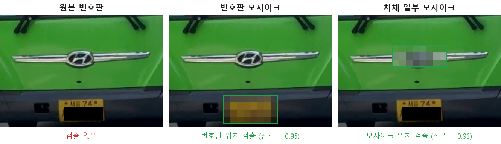
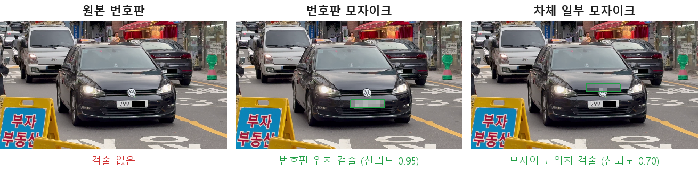
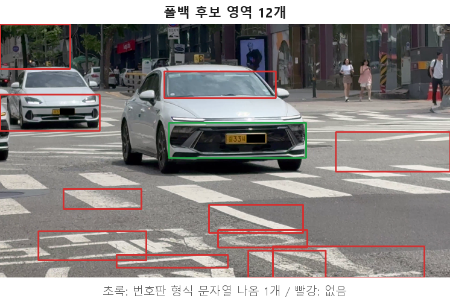
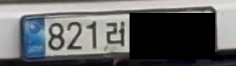
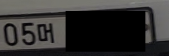
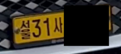
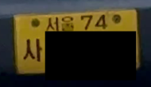
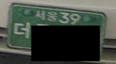
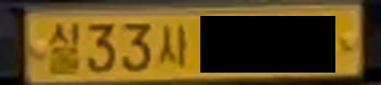

# 검출·OCR 검증 실험

이전 버전(YOLO n + EasyOCR)은 직접 촬영한 도로 영상에서 번호판을 거의 읽지 못했다.
YOLO가 번호판을 찾지 못하면 색상·윤곽선 기반 후보 검출(이하 폴백)로 넘어가는데,
대부분의 프레임이 이 경로로 처리되었다.
인식 실패의 원인이 **검출 단계**인지 **OCR 단계**인지 구분하기 위해 조건을 하나씩 바꾸어 비교했다.

> 이전 버전의 YOLO n 가중치는 남아 있지 않아 현재 모델(YOLOv11m)과 현재 폴백 코드로 측정했다.

## 실험 조건

| 항목 | 내용 |
|---|---|
| 영상 | 길가에서 눈높이로 직접 촬영한 도로 영상 6개 (총 약 3분) |
| 프레임 | 1초 간격 185장, 가로 1280px로 축소 |
| 검출·OCR 코드 | 앱 코드(`detector.py`, `ocr_engine.py`, `pipeline.py`)를 수정 없이 불러와 사용 |
| EasyOCR 조건 | 앱 `read_plate`와 같은 신뢰도 기준·정규식·2줄 번호판 줄 순서 재시도 |
| 정답 확인 | 번호판 형식 문자열이 나온 영역 32개를 눈으로 대조 |
| OCR 단독 비교 | 프레임에서 번호판 영역 21개(차량 17대)를 직접 지정해 잘라낸 이미지 |

## 결과 요약

| 비교 | 바꾼 조건 | 결과 |
|---|---|---|
| 1 | 같은 번호판을 원본 / 모자이크로 바꾸어 YOLO 검출 | 원본 0건, 모자이크 21건 (22개 중). 검출 실패 원인은 학습 데이터의 번호판 모자이크 |
| 2 | YOLO 검출 / 폴백 검출 | YOLO 0건, 폴백 후보 640개 중 번호판 형식 문자열 32개(5.0%) |
| 3 | 같은 번호판 영역을 PaddleOCR / EasyOCR로 인식 | PaddleOCR 15/21, EasyOCR 13/21. 영역이 정확하면 두 OCR 모두 대부분 인식 |
| 4 | 한글 검사 없음 / 적용 | 오답 7건에서 1건, 정답 21건 유지 |

---

## 비교 1. 원본 번호판 vs 모자이크 번호판 (YOLO 검출)

학습에 쓴 AIHub 이미지는 개인정보 보호를 위해 번호판이 모자이크되어 있다.
같은 영역에서 번호판을 모자이크하거나, 번호판은 그대로 두고 차체 일부를 모자이크한 뒤 YOLO 검출 결과를 비교했다.





| 조건 | 바꾼 것 | 차량 중심 영역 | 전체 프레임 |
|---|---|---|---|
| 원본 번호판 | 없음 | 0 / 22 | 0 / 22 |
| 번호판 모자이크 | 번호판 영역을 가로 8칸 모자이크 | 21 / 22 | 14 / 22 |
| 차체 일부 모자이크 | 번호판은 그대로, 번호판 위쪽 차체를 같은 크기로 모자이크 | 7 / 10 | 5 / 22 |

**결과**
- 글자가 보이는 실제 번호판은 한 건도 검출하지 못했지만, 같은 번호판을 모자이크하면 검출했다.
- 번호판이 아닌 차체를 모자이크해도 그 위치를 번호판으로 검출했다.
- 모델은 글자가 있는 번호판이 아니라 **모자이크 무늬**를 번호판으로 학습했다.
- n보다 큰 m 모델도 0건이므로 모델 크기는 원인이 아니었다.
- 검증 데이터도 같은 모자이크 데이터라서, 검증 mAP50 0.931은 실제 번호판 검출 성능을 나타내지 않는다.

> 대조군 영역은 번호판 높이의 2배만큼 위(벗어나면 아래)로 옮긴 같은 크기 영역이다.
> 차량 중심 영역 대조군은 이미지 경계를 벗어나지 않는 10개만 측정했다.

## 비교 2. YOLO 검출 vs 폴백 검출



| 검출 방식 | 185프레임에서 나온 영역 | 번호판 형식 문자열이 나온 영역 |
|---|---|---|
| YOLOv11m | 0 | 0 |
| 폴백 (이진화·윤곽선·색상) | 640 (프레임당 평균 3.5) | 32 (5.0%) |

**결과**
- 위 프레임의 후보 12개 중 번호판 형식 문자열이 나온 것은 1개(초록, 차량 앞부분 전체)다.
  나머지 11개는 횡단보도 10개 남짓한 줄무늬, 건물, 차량 유리, 멀리 있는 차량 앞부분이었다.
- 번호판 형식 문자열이 나온 영역 32개 중 18개도 번호판만이 아니라 차량 앞부분이나 뒷부분 전체였다.
- 이전 버전에서 검출 실패 후 폴백으로 넘어가 번호를 거의 읽지 못한 현상과 일치한다.

## 비교 3. PaddleOCR vs EasyOCR (같은 번호판 영역)

검출 단계 영향을 빼기 위해 번호판 영역을 직접 지정해 잘라내고, 두 OCR을 같은 후처리 규칙으로 비교했다.

| 번호판 | 이미지 | PaddleOCR | EasyOCR |
|---|---|---|---|
| 흰색 |  | 821러 ●●●● (정답) | 821리 ●●●● ('러'를 '리'로) |
| 흰색 |  | 05모 ●●●● ('머'를 '모'로) | 05머 ●●●● (정답) |
| 노란 영업용 1줄 |  | 31사 ●●●● (정답) | 형식 추출 실패. '서울'을 '설'로 읽고 숫자 하나 누락 |
| 노란 영업용 2줄 |  | 읽지 못함 | 74사 ●●●● (정답) |
| 녹색 구형 2줄 |  | 읽지 못함 | 읽지 못함 |

| 번호판 종류 | 영역 수 | PaddleOCR | EasyOCR |
|---|---|---|---|
| 흰색 | 10 | 9 | 8 |
| 노란 영업용 1줄 | 7 | 5 | 3 |
| 노란 영업용 2줄 | 2 | 1 | 2 |
| 녹색 구형 2줄 | 2 | 0 | 0 |
| **합계** | **21** | **15 (71.4%)** | **13 (61.9%)** |

폴백 영역(비교 2)에서도 같은 경향이었다.

| 항목 | PaddleOCR | EasyOCR |
|---|---|---|
| 번호판 형식 출력 | 28 | 19 |
| 그중 정답 | 21 | 14 |
| 정답 차량 수 (중복 제외) | 14 | 9 |

**결과**
- 번호판 영역이 정확하면 EasyOCR도 흰색 번호판 10개 중 8개를 읽었다. 이전 버전 인식 실패의 주원인은 OCR이 아니라 검출 단계였다.
- PaddleOCR을 유지한 근거는 노란 영업용 1줄 번호판(5/7 대 3/7)이다.
  EasyOCR은 왼쪽의 작은 세로 글자 '서울'을 '설'·'심' 같은 한 글자로 읽으면서 바로 옆 숫자나 한글까지 잘못 읽었다.
- 노란 영업용 2줄 번호판은 EasyOCR이 더 나았다(2/2 대 1/2).
- 녹색 구형 2줄 번호판은 두 OCR 모두 읽지 못했다.

## 비교 4. 한글 검사 없음 vs 적용

두 OCR의 오답은 대부분 번호판에 쓰지 않는 한글이 들어간 경우였다.
아래 번호판은 '사'의 짧은 가로획이 흐려 두 OCR 모두 '시'로 읽었다.



번호판 용도 기호 40자(비사업용 32자, 사업용·택배 5자, 렌터카 3자)에 없는 한글이 나오면 결과를 버리도록
`pipeline.py`에 검사를 추가했다. 등록 차량 번호와 정확히 같으면 통과시킨다.
같은 입력(PaddleOCR이 번호판 형식 문자열을 낸 폴백 영역 28개)을 앱 처리 경로 `process_tracked_roi`로 처리해 비교했다.

| 조건 | 저장 | 정답 | 오답 |
|---|---|---|---|
| 한글 검사 없음 | 28 | 21 | 7 |
| 한글 검사 적용 | 22 | 21 | 1 |

**결과**
- 오답 7건 중 6건을 걸러냈고, 정답은 한 건도 걸리지 않았다.
- 남은 1건은 '머'를 '모'로 읽은 경우다. '모'도 번호판에 쓰는 글자라 검사로 걸러지지 않는다.
- 버린 결과는 기록하지 않고, 영상 모드에서는 같은 추적 ID를 0.5초 뒤 다시 읽는다.

---

## 개선 방향

| 문제 | 방향 |
|---|---|
| 모자이크 번호판으로 학습한 검출 모델 | 번호판이 가려지지 않은 이미지로 재학습 (직접 촬영 영상 라벨링 등) |
| 녹색 구형 2줄 번호판 | 위·아래 줄을 나누어 따로 인식 |
| 한글 검사로 걸러지지 않는 오답('머'와 '모' 등) | 여러 프레임 결과 투표(`VOTE_FRAMES`) 활용 |

## 개인정보

- 실험 영상, 원본 번호판 이미지, 번호 원문은 저장소에 올리지 않는다. `data/` 폴더는 `.gitignore`로 제외했다.
- `images/`의 공개용 그림은 번호 끝 4자리를 검은 상자로 가렸다. 배경의 작은 번호판은 글자 상자 전체를 가렸다.
- 가림은 YOLO 검출과 OCR이 끝난 뒤 그림에만 적용했으므로 실험 결과에는 영향이 없다.

## 실행 순서

```bash
# 1단계 (lpr_env): 영상 프레임에서 YOLO·폴백 후보 영역 추출 + PaddleOCR
python step1_crops_paddle.py --videos 영상폴더 --out data --files 영상1.mp4 영상2.mp4 ...

# 2단계 (lpr_env): 직접 지정한 번호판 영역(data/gt/plates, data/gt/gt_labels.csv) + PaddleOCR
python step2_gt_paddle.py --gt data/gt

# 3단계 (EasyOCR 전용 가상환경): 같은 이미지를 EasyOCR로 읽기
python step3_easyocr.py --csv data/crops_paddle.csv --images data/crops --out data/crops_both.csv
python step3_easyocr.py --csv data/gt/gt_paddle.csv --images data/gt/plates --out data/gt/gt_both.csv

# 4단계 (lpr_env): 번호판 모자이크 여부에 따른 YOLO 검출 비교
python step4_mosaic_check.py --videos 영상폴더 --data data --files 영상1.mp4 영상2.mp4 ...

# 5단계: 집계 (data/crops_checked.csv에 눈으로 확인한 정답 기록 후 실행)
python step5_summary.py --data data --frames 185

# 6단계 (lpr_env): 한글 검사 적용 전후 비교 (임시 DB 사용)
python step6_hangul_check.py --data data

# 그림 생성 (lpr_env): images/*.png
python make_figures.py --videos 영상폴더 --data data --files 영상1.mp4 영상2.mp4 ... --crop v2_f00175_fallback_0 v1_f00250_fallback_0
```

| 파일 | 역할 |
|---|---|
| `common.py` | 4단계·그림 생성 공통 함수 (프레임 불러오기, 번호판 위치, 모자이크, YOLO 검출, 공개용 가림) |
| `step1` ~ `step6` | 실험 단계별 스크립트 |
| `make_figures.py` | README 비교 그림 생성 |

EasyOCR은 별도 가상환경에서 실행한다.
EasyOCR 1.7.2를 설치하면 numpy 2.x와 opencv-python-headless 5.x가 함께 설치되는데,
lpr_env는 paddlepaddle 2.6 때문에 numpy 1.26, opencv 4.6으로 고정되어 있기 때문이다.
